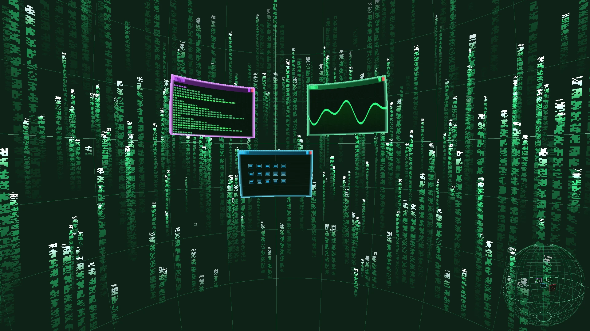

# XSphereDE

**A spherical 3D desktop environment prototype written in safe Rust, rendered with `wgpu`, designed around explicit trust domains.**

[](https://github.com/mendsec/xspherede/actions/workflows/ci.yml)
[](LICENSE)
[](Cargo.toml)
[](Cargo.toml)
[](#project-status)



*The v0.0.1 prototype: demo windows in three trust domains, with the Mini-Globe overview in the corner.*

XSphereDE places you at the center of a 360° sphere. Windows are curved meshes that sit on the sphere at a position and depth $(\theta, \phi, r)$, and every window carries a compositor-drawn border that tells you which trust domain it belongs to. It revives the idea behind the classic SphereXP desktop and asks what it would look like if it were built today: memory-safe, GPU-native, Wayland-first, and with isolation as a visible, first-class concept instead of an afterthought.

---

## Project status

**Early prototype (v0.0.1). Not a daily driver, and not yet a security boundary.**

What exists today is a single-process renderer and interaction model: the sphere, the camera, curved windows, the Mini-Globe overview, and the security policy engine, all exercised against built-in demo window surfaces. It does not yet host real applications.

What that means in practice:

- It runs as a regular window on your existing desktop. It is not a Wayland compositor or a login session yet.
- The trust-domain and clipboard-vault logic is implemented and unit-tested, but it has no untrusted clients to isolate yet. **Do not rely on it to protect anything.**
- Interfaces, shortcuts, and file layout will change without notice until `0.1.0`.

The path from here to a real compositor session is laid out in the [roadmap](#roadmap), and that is exactly where contributors can have the most impact.

---

## Why this project

- **Spatial workspaces without a headset.** A sphere gives you far more usable surface than a flat plane, with depth as a third axis for arranging work, on ordinary monitors and ordinary GPUs.
- **Isolation you can see.** Borrowing from the Qubes OS model, a window's trust level is part of the desktop's visual language and is drawn by the compositor, never by the application.
- **Hardened defaults, not hardened options.** The policy baseline follows the direction set by projects such as secureblue: no Xwayland, no automatic thumbnailers, no third-party code inside the compositor.
- **A small, auditable codebase.** About 3,300 lines of Rust and WGSL, seven direct dependencies, `unsafe` forbidden at the crate level.

---

## Features

### Spherical workspace

- Geodesic wireframe sphere with meridians, parallels, a highlighted equator, and polar rings.
- Smoothly damped camera with 360° orbital rotation and free flight inside the sphere.
- Curved windows (16×12 subdivided meshes) that match the sphere's curvature at their own radius, adjustable from 4.0 m to 24.5 m.
- Exact spherical raycasting for focus, hover, dragging across $(\theta, \phi)$, and depth adjustment.

### Mini-Globe overview

- An external 3D view of the sphere in the corner of the screen showing every window at its true radial depth.
- Rotate it, adjust window depth from it, expand it to the center of the screen as an overview, or click any window or coordinate to fly the main camera there.

### Volumetric code rain

- Hundreds of 3D glyph ribbons generated procedurally in a WGSL shader; the camera can fly between the columns.
- The effect never gets in the way of work: a clear radius around the viewer, a frontal reading cone, and a per-window angular shield keep the rain from covering any window.

### Security model

These are the mechanisms implemented in [`src/security.rs`](src/security.rs) and the compositor shader today. See [project status](#project-status) for what they do and do not guarantee at this stage.

- **Trust domains.** Every window is bound to one of four domains (`CORE-VAULT`, `TRUSTED`, `SANDBOX`, `QUARANTINE`). The colored frame is rendered by the compositor's own fragment shader on top of the window surface, so window content cannot draw or alter it.
- **Inter-domain clipboard vault.** Copy and paste between windows goes through a compositor-owned vault on dedicated shortcuts, with an integrity check on the source and destination domains and a single-use wipe after paste.
- **Lockdown mode.** One key blanks every window surface and wipes the vault.
- **Surface validation.** Window buffers are bounds-checked against fixed dimension and size limits before they reach the GPU.
- **Shader integrity check.** The WGSL source is hashed with SHA-256 and compared against a pinned digest before it is compiled.
- **Host audit.** A read-only startup and on-demand (`F12`) report on relevant kernel settings (`ptrace_scope`, `kptr_restrict`, `dmesg_restrict`), injected-library environment variables, and allocator hardening.
- **Policy baseline.** `SecurityPolicy::maximum_hardened()` declares the defaults the future compositor session will enforce: Xwayland off, no automatic thumbnailers, no third-party shell extensions, no setuid helpers.
- **Build hardening.** `unsafe_code = "forbid"`, integer overflow checks enabled in release builds, `panic = "abort"`, fat LTO, stripped symbols, and a committed `Cargo.lock`.

---

## Platform support

| Platform | Status |
| :--- | :--- |
| Linux (Wayland, X11) | Primary development target |
| FreeBSD | Expected to work through Vulkan or GLES; compile-checked in CI as an experimental job. Reports welcome |
| OpenBSD, NetBSD, DragonFly BSD | Untested. Reports and patches welcome |
| Windows, macOS | Should run through `wgpu` and `winit`; not a project focus |

If you run XSphereDE on a BSD or an unusual GPU and driver combination, please open an issue with the result, whether it worked or not.

---

## Building and running

### Requirements

- Rust 1.88 or newer (`rustup` recommended).
- A GPU driver exposing Vulkan, or OpenGL / GLES as a fallback.
- On Linux and the BSDs, the usual desktop runtime libraries: `libxkbcommon`, plus `libwayland-client` or `libX11`. They are loaded at run time and are already present on virtually any desktop install.

### Run

```bash
git clone https://github.com/mendsec/xspherede.git
cd xspherede
cargo run --release --locked
```

To see the security audit and policy messages, raise the log level:

```bash
RUST_LOG=info cargo run --release --locked
```

### Test

```bash
cargo test --locked
```

---

## Controls

| Action | Control |
| :--- | :--- |
| Rotate the view | Drag with the right mouse button, or the left button on the background |
| Toggle continuous free-look | `Space` or `Tab` |
| Fly through the sphere | Mouse wheel on empty space, or `W` `A` `S` `D` (`Q` / `E` for down / up, `Shift` to boost) |
| Move a window across the sphere | Drag it with the left mouse button |
| Change a window's depth | Hover the window (main view or Mini-Globe) and scroll |
| Rotate the Mini-Globe | Drag it, or scroll over its empty space |
| Jump to a point or window | Left click inside the Mini-Globe |
| Expand or collapse the Mini-Globe | Right or middle click on it, or `G` |
| Copy focused window into the clipboard vault | `Ctrl` + `Shift` + `C` |
| Paste from the clipboard vault | `Ctrl` + `Shift` + `V` |
| Toggle lockdown mode | `L` |
| Run the host security audit | `F12` |
| Recenter at the sphere core | `R` or `Home` |
| Toggle code rain speed | `M` |
| Toggle fullscreen | `F11` or `F` |
| Collapse the Mini-Globe, or exit | `Esc` |

---

## Architecture

```text
xspherede/
├── Cargo.toml          # Manifest and hardened build profiles
├── Cargo.lock          # Pinned dependency graph
├── docs/               # Screenshots and media
└── src/
    ├── main.rs         # wgpu / winit setup, event loop, render pipelines, lockdown mode
    ├── camera.rs       # SphereCamera: damped spatial camera and NDC raycasting
    ├── window3d.rs     # SphericalWindow: curved meshes, spherical raycasting, WindowSurfaceProvider
    ├── minimap.rs      # MiniGlobeHud: interactive, expandable overview globe
    ├── sphere_env.rs   # Geodesic grid and code rain volume generation
    ├── security.rs     # TrustDomain, SecureClipboardVault, SecurityPolicy, audit, SHA-256
    └── shader.wgsl     # Grid, glyph, window, and trust-border shaders
```

The key extension point is the `WindowSurfaceProvider` trait in [`src/window3d.rs`](src/window3d.rs). Anything that can produce a title, a trust domain, dimensions, and an RGBA buffer can become a window on the sphere. The demo surfaces implement it today; real window sources are the next step.

---

## Roadmap

Done:

- [x] Spherical workspace with 360° navigation and free flight
- [x] Curved windows with spherical raycasting, dragging, and radial depth
- [x] Interactive Mini-Globe overview with true-depth window rendering
- [x] Trust domains, clipboard vault, lockdown mode, and host audit
- [x] Volumetric code rain with reading cone and per-window shield

Next:

- [ ] Live window capture through PipeWire, as the first real `WindowSurfaceProvider`
- [ ] Native Wayland compositor session built on Smithay, with zero-copy DMA-BUF textures
- [ ] Per-domain process isolation, so trust domains map to real sandboxes
- [ ] Input routing to client surfaces through a trusted input path
- [ ] Polar docks and launchers on the upper and lower rings
- [ ] Verified BSD support and distribution packaging

---

## Contributing

Contributions are welcome, and the project is small enough that a first patch can land in an afternoon. Good places to start:

- **Test on your system.** BSD, non-Mesa drivers, multi-monitor, and HiDPI reports are all valuable.
- **Pick a roadmap item.** PipeWire capture and the Smithay session are the two that unlock everything else.
- **Review the security model.** Design feedback from people who work on compositors, sandboxing, or hardened distributions is especially wanted. Use private reporting for anything sensitive.

Read [CONTRIBUTING.md](CONTRIBUTING.md) before opening a pull request, and note the [Code of Conduct](CODE_OF_CONDUCT.md).

---

## Security

Please do not open public issues for security vulnerabilities. See [SECURITY.md](SECURITY.md) for private reporting.

---

## Acknowledgements

XSphereDE is an independent project. It is inspired by, and not affiliated with or endorsed by, any of the following:

- **SphereXP**, the original spherical desktop, for the core idea.
- **Qubes OS**, for trust domains and compositor-owned window decorations.
- **secureblue** and **GrapheneOS**, for the hardened-by-default policy direction.
- **wgpu**, **winit**, and **Smithay**, for making a project like this feasible in safe Rust.

---

## License

Distributed under the MIT License. See [LICENSE](LICENSE).
