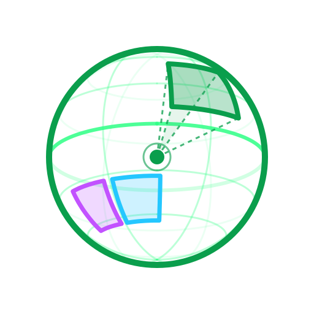
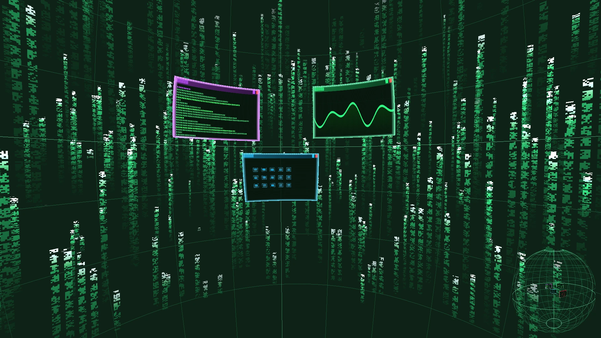

<p align="center">
  <picture>
    <source media="(prefers-color-scheme: dark)" srcset="docs/brand/spheradian-logo-transparent.svg">
    
  </picture>
</p>

# Spheradian

**A spherical 3D desktop environment prototype written in safe Rust, rendered with `wgpu`, designed around explicit trust domains.**

[](https://github.com/spheradian/spheradian/actions/workflows/ci.yml)
[](LICENSE)
[](Cargo.toml)
[](Cargo.toml)
[](#project-status)

**Website and browser demos:** https://spheradian.github.io/spheradian/



*The v0.0.1 prototype: demo windows in three trust domains, with the Mini-Globe overview in the corner.*

Spheradian places you at the center of a 360° sphere. Windows are curved meshes that sit on the sphere at a position and depth $(\theta, \phi, r)$, and every window carries a compositor-drawn border that tells you which trust domain it belongs to. It revives the idea behind the classic SphereXP desktop and asks what it would look like if it were built today: memory-safe, GPU-native, Wayland-first, and with isolation as a visible, first-class concept instead of an afterthought.

> **About the name:** Spheradian was formerly called XSphereDE. The name joins *sphere*, after SphereXP, which inspired the project, with *radian*, after the steradian: the unit of solid angle, which measures how much of the sphere each window takes up. See [#17](https://github.com/spheradian/spheradian/issues/17) for the naming discussion.

The sphere is not a planet's globe: it stands for the [shape of the universe](https://en.wikipedia.org/wiki/Shape_of_the_universe), finite and closed. Windows gather into clusters that behave like galaxies, each with its own center, and you travel between them.

---

## Project status

**Early prototype (v0.0.1). Not a daily driver, and not yet a security boundary.**

What exists today is a single-process renderer and interaction model: the sphere, the camera, curved windows, the Mini-Globe overview, and the security policy engine, all exercised against built-in demo window surfaces. It does not yet host real applications.

What that means in practice:

- It runs as a regular window on your existing desktop. It is not a Wayland compositor or a login session yet.
- The trust-domain and clipboard-vault logic is implemented and unit-tested, but it has no untrusted clients to isolate yet. **Do not rely on it to protect anything.**
- Interfaces, shortcuts, and file layout will change without notice until `0.1.0`.

The path from here to a real compositor session is laid out in the [roadmap](#roadmap), and that is exactly where contributors can have the most impact.

---

## Why this project

- **Spatial workspaces without a headset.** A sphere gives you far more usable surface than a flat plane, with depth as a third axis for arranging work, on ordinary monitors and ordinary GPUs.
- **Isolation you can see.** Borrowing from the Qubes OS model, a window's trust level is part of the desktop's visual language and is drawn by the compositor, never by the application.
- **Hardened defaults, not hardened options.** The policy baseline follows the direction set by projects such as secureblue: no Xwayland, no automatic thumbnailers, no third-party code inside the compositor.
- **A small, auditable codebase.** About 5,600 lines of Rust and WGSL, seven direct dependencies, `unsafe` forbidden at the crate level.

---

## Features

### Spherical workspace

- Geodesic wireframe sphere with meridians, parallels, a highlighted equator, and polar rings.
- Smoothly damped camera with 360° orbital rotation and free flight inside the sphere.
- Curved windows (16×12 subdivided meshes) that match the sphere's curvature at their own radius, adjustable from 4.0 m to 24.5 m.
- Exact spherical raycasting for focus, hover, dragging across $(\theta, \phi)$, and depth adjustment.

### Universe and galaxies

- The outer wireframe sphere is the boundary of the universe; the camera can fly anywhere inside it.
- Windows are grouped into galaxies. Each galaxy has its own center and a wireframe halo, and its windows' $(\theta, \phi, r)$ are measured from that center.
- Travel between galaxies with an eased flight that turns toward the destination and briefly widens the field of view, then faces the galaxy's first window on arrival.
- Flying into another galaxy's halo by hand also makes it the current galaxy.
- Inside a galaxy, only that galaxy is drawn. The universe boundary and other galaxies appear as faint outlines only while you aim a warp, during a flight, or in deep space.
- Space warp: hold the left and right mouse buttons together and drag to turn toward another galaxy. When its halo sits at the center of the view, release either button to warp there. A short drag or `Esc` cancels, so pressing both buttons by accident never leaves the galaxy.
- Cosmic Zoom-Out (`U`): the camera pulls straight back until the whole universe is in view, then orbits it. Every galaxy shows its halo and live windows, without code rain. Windows of the same trust domain are linked across galaxies, like the edges of a graph view, so you can see at a glance where each domain lives. Hovering a galaxy dims the others and its links. Click a galaxy to dive in, click a window to dive in and focus it, or drag a window onto another galaxy to move it there.
- Start the chord while dragging a window to carry that window along. It keeps its trust domain and its placement, and stays focused on arrival.
- Keyboard focus is cleared on arrival, so traveling never silently moves focus into another trust domain.

### Mini-Globe overview

- An external 3D view of the current galaxy in the corner of the screen showing its windows at their true radial depths.
- Rotate it, adjust window depth from it, expand it to the center of the screen as an overview, or click any window or coordinate to fly the main camera there.

### Volumetric code rain

- Hundreds of 3D glyph ribbons generated procedurally in a WGSL shader; the camera can fly between the columns.
- The effect never gets in the way of work: a clear radius around the viewer, a frontal reading cone, and a per-window angular shield keep the rain from covering any window.

### Security model

These are the mechanisms implemented in [`src/security.rs`](src/security.rs) and the compositor shader today. See [project status](#project-status) for what they do and do not guarantee at this stage.

- **Trust domains.** Every window is bound to one of four domains (`CORE-VAULT`, `TRUSTED`, `SANDBOX`, `QUARANTINE`). The colored frame is rendered by the compositor's own fragment shader on top of the window surface, so window content cannot draw or alter it.
- **Inter-domain clipboard vault.** Copy and paste between windows goes through a compositor-owned vault on dedicated shortcuts, with an integrity check on the source and destination domains and a single-use wipe after paste.
- **Lockdown mode.** One key blanks every window surface and wipes the vault.
- **Surface validation.** Window buffers are bounds-checked against fixed dimension and size limits before they reach the GPU.
- **Shader integrity check.** The WGSL source is hashed with SHA-256 and compared against a pinned digest before it is compiled.
- **Host audit.** A read-only startup and on-demand (`F12`) report on relevant Linux kernel settings (`ptrace_scope`, `kptr_restrict`, `dmesg_restrict`; shown as `n/a` on other systems), injected-library environment variables, and allocator hardening.
- **Policy baseline.** `SecurityPolicy::maximum_hardened()` declares the defaults the future compositor session will enforce: Xwayland off, no automatic thumbnailers, no third-party shell extensions, no setuid helpers.
- **Build hardening.** `unsafe_code = "forbid"`, integer overflow checks enabled in release builds, `panic = "abort"`, fat LTO, stripped symbols, and a committed `Cargo.lock`.

---

## Platform support

| Platform | Status |
| :--- | :--- |
| Linux (Wayland, X11) | Primary development target |
| FreeBSD, NetBSD | Compiles: cross-checked in CI on every change. Not yet tested at run time; expected to work through Vulkan or GLES. Reports welcome |
| OpenBSD | Compiles: cross-checked in CI on every change with a nightly toolchain. Not yet tested at run time; see [OpenBSD](#openbsd). Reports welcome |
| DragonFly BSD | Untested. Reports and patches welcome |
| Windows, macOS | Should run through `wgpu` and `winit`; not a project focus |

If you run Spheradian on a BSD or an unusual GPU and driver combination, please open an issue with the result, whether it worked or not.

---

## Building and running

### Requirements

- Rust 1.88 or newer (`rustup` recommended).
- A GPU driver exposing Vulkan, or OpenGL / GLES as a fallback.
- On Linux and the BSDs, the usual desktop runtime libraries: `libxkbcommon`, plus `libwayland-client` or `libX11`. They are loaded at run time and are already present on virtually any desktop install.

### Run

```bash
git clone https://github.com/spheradian/spheradian.git
cd spheradian
cargo run --release --locked
```

To see the security audit and policy messages, raise the log level:

```bash
RUST_LOG=info cargo run --release --locked
```

### Test

```bash
cargo test --locked
```

### OpenBSD

Spheradian type-checks for OpenBSD in CI but has not been run there yet, so these steps are a starting point rather than a verified recipe. Please [open a platform report](https://github.com/spheradian/spheradian/issues/new?template=platform_report.yml) with what you find.

- `rustup` is not available on OpenBSD. Install the toolchain from packages and confirm that `rustc --version` reports 1.88 or newer:

  ```bash
  pkg_add rust git libxkbcommon vulkan-loader
  ```

- Run from an X11 session. `libxkbcommon` is required; `vulkan-loader` is optional, and without it the renderer falls back to OpenGL / GLES.
- The release profile uses fat LTO, which can exceed the default data size limit of a login class. Start with a debug build, or raise the limit with `ulimit -d` before a release build:

  ```bash
  RUST_LOG=info cargo run --locked
  ```

- If no window appears, the `RUST_LOG=info` output shows the selected GPU and graphics backend, or the error that stopped startup. Include it in the report.

---

## Controls

| Action | Control |
| :--- | :--- |
| Rotate the view | Drag with the right or middle mouse button, or the left button on the background |
| Toggle continuous free-look | `Space` or `Tab` |
| Fly through the sphere | Mouse wheel on empty space, or `W` `A` `S` `D` (`Q` / `E` for down / up, `Shift` to boost) |
| Move a window across the sphere | Drag it with the left mouse button |
| Change a window's depth | Hover the window (main view or Mini-Globe) and scroll |
| Rotate the Mini-Globe | Drag it, or scroll over its empty space |
| Jump to a point or window | Left click inside the Mini-Globe |
| Expand or collapse the Mini-Globe | Right or middle click on it, or `G` |
| Copy focused window into the clipboard vault | `Ctrl` + `Shift` + `C` |
| Paste from the clipboard vault | `Ctrl` + `Shift` + `V` |
| Toggle lockdown mode | `L` |
| Run the host security audit | `F12` |
| Travel to the previous or next galaxy | `Ctrl` + `PageUp` / `PageDown` |
| Travel to galaxy 1 to 9 | `Ctrl` + `1` … `9` |
| Space warp to the galaxy in view | Hold left + right buttons, drag until it locks, release |
| Carry a window through a warp | Drag the window, then press the right button too |
| Cosmic Zoom-Out: see the whole universe | `U` (again, or `Esc`, to dive back) |
| In the overview: orbit, zoom | Drag, scroll |
| In the overview: dive into a galaxy or window | Click it |
| In the overview: move a window to another galaxy | Drag it onto that galaxy |
| Recenter in the current galaxy | `R` or `Home` |
| Toggle code rain speed | `M` |
| Toggle fullscreen | `F11` or `F` |
| Leave the overview, cancel a warp, collapse the Mini-Globe, or exit | `Esc` |

---

## Architecture

```text
spheradian/
├── Cargo.toml          # Manifest and hardened build profiles
├── Cargo.lock          # Pinned dependency graph
├── docs/               # Screenshots and media
└── src/
    ├── main.rs         # wgpu / winit setup, event loop, render pipelines, lockdown mode
    ├── camera.rs       # SphereCamera: damped spatial camera and NDC raycasting
    ├── galaxy.rs       # Galaxy: window clusters, universe and galaxy radii, demo universe
    ├── warp.rs         # WarpGesture: left + right mouse chord and galaxy aiming
    ├── overview.rs     # CosmicOverview: universe orbit, galaxy picking, trust links
    ├── window3d.rs     # SphericalWindow: curved meshes, spherical raycasting, WindowSurfaceProvider
    ├── minimap.rs      # MiniGlobeHud: interactive, expandable overview globe
    ├── sphere_env.rs   # Geodesic grid and code rain volume generation
    ├── security.rs     # TrustDomain, SecureClipboardVault, SecurityPolicy, audit, SHA-256
    └── shader.wgsl     # Grid, glyph, window, and trust-border shaders
```

The key extension point is the `WindowSurfaceProvider` trait in [`src/window3d.rs`](src/window3d.rs). Anything that can produce a title, a trust domain, dimensions, and an RGBA buffer can become a window on the sphere. The demo surfaces implement it today; real window sources are the next step.

---

## Roadmap

Planned work is tracked on the **[Spheradian Roadmap project board](https://github.com/users/mendsec/projects/6)**, grouped by phase, and in issues with the [`roadmap`](https://github.com/spheradian/spheradian/issues?q=is%3Aissue+is%3Aopen+label%3Aroadmap) label. The list below is a summary; the board is the source of truth for status.

Done:

- [x] Spherical workspace with 360° navigation and free flight
- [x] Curved windows with spherical raycasting, dragging, and radial depth
- [x] Interactive Mini-Globe overview with true-depth window rendering
- [x] Trust domains, clipboard vault, lockdown mode, and host audit
- [x] Volumetric code rain with reading cone and per-window shield
- [x] Galaxies of windows across a closed universe, with keyboard and space warp travel between them
- [x] Cosmic Zoom-Out overview of the universe with trust-domain links between galaxies

Next:

- [ ] Live window capture through PipeWire, as the first real `WindowSurfaceProvider` ([#21](https://github.com/spheradian/spheradian/issues/21))
- [ ] Native Wayland compositor session built on Smithay, with zero-copy DMA-BUF textures ([#22](https://github.com/spheradian/spheradian/issues/22))
- [ ] Per-domain process isolation, so trust domains map to real sandboxes ([#24](https://github.com/spheradian/spheradian/issues/24))
- [ ] Input routing to client surfaces through a trusted input path ([#23](https://github.com/spheradian/spheradian/issues/23))
- [ ] Polar docks and launchers on the upper and lower rings ([#25](https://github.com/spheradian/spheradian/issues/25))
- [ ] Spatial file manager, currently a concept prototype in [Spheradian Files](https://github.com/spheradian/files)
- [ ] Verified BSD support ([#28](https://github.com/spheradian/spheradian/issues/28)) and distribution packaging ([#29](https://github.com/spheradian/spheradian/issues/29))

---

## Ecosystem

- **[Spheradian Files](https://github.com/spheradian/files)**: the file manager concept for Spheradian. Folders appear as a city whose structures show size and density, and a 3D sector map draws your route between folders and any pending copy or cut action. [Try the live demo](https://spheradian.github.io/files/) in your browser.

---

## Contributing

Contributions are welcome, and the project is small enough that a first patch can land in an afternoon. Good places to start:

- **Test on your system.** BSD, non-Mesa drivers, multi-monitor, and HiDPI reports are all valuable.
- **Pick a roadmap item** from the [project board](https://github.com/users/mendsec/projects/6). PipeWire capture and the Smithay session are the two that unlock everything else; [`good first issue`](https://github.com/spheradian/spheradian/issues?q=is%3Aissue+is%3Aopen+label%3A%22good+first+issue%22) items are smaller entry points.
- **Review the security model.** Design feedback from people who work on compositors, sandboxing, or hardened distributions is especially wanted. Use private reporting for anything sensitive.

Read [CONTRIBUTING.md](CONTRIBUTING.md) before opening a pull request, and note the [Code of Conduct](CODE_OF_CONDUCT.md).

---

## Security

Please do not open public issues for security vulnerabilities. See [SECURITY.md](SECURITY.md) for private reporting.

---

## Acknowledgements

Spheradian is an independent project. It is inspired by, and not affiliated with or endorsed by, any of the following:

- **SphereXP**, the original spherical desktop, for the core idea.
- **Qubes OS**, for trust domains and compositor-owned window decorations.
- **secureblue** and **GrapheneOS**, for the hardened-by-default policy direction.
- **wgpu**, **winit**, and **Smithay**, for making a project like this feasible in safe Rust.

---

## License

Distributed under the Apache License, Version 2.0. See [LICENSE](LICENSE) and [NOTICE](NOTICE).

The license does not grant rights to the Spheradian name. See [TRADEMARKS.md](TRADEMARKS.md) for how the name may be used.
